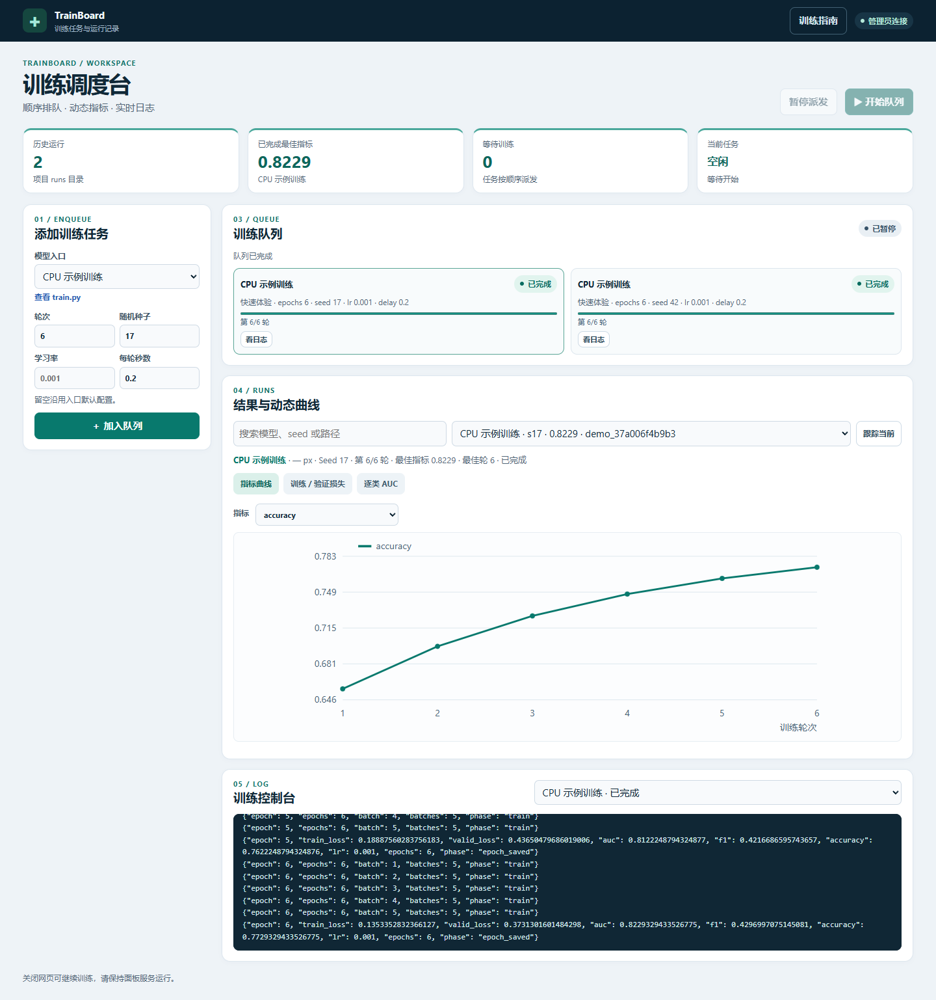

# TrainBoard

轻量 Python 训练调度与观测面板。把已有的训练脚本接入配置，就能从浏览器顺序排队、观察实时日志和指标、切换历史训练结果，并给队友提供只读观测链接。



## 功能

- 训练任务顺序运行，支持排队、调序、移除、暂停派发和停止当前任务。
- 每个训练入口独立设置 Python 解释器、工作目录、固定参数和可调超参数。
- 自动捕获标准输出和错误输出，队列与日志持久化到本地。
- 动态展示 CSV / JSONL 指标，支持任意数值指标、损失曲线、逐类 AUC 和已有图片。
- 管理员控制和队友只读观测使用不同访问密钥。
- Windows、Linux、macOS 使用同一套 Python 服务，前端静态资源随包离线提供。
- 自带纯 CPU 合成训练示例，用来体验功能和调试接入。

默认单进程串行调度。每个实例管理一个队列，可以运行在 GPU 主机上，通过浏览器或 SSH 隧道访问。

## 快速开始

需要 Python 3.10+。在项目目录运行。

```bash
python -m venv .venv
```

Windows PowerShell 激活虚拟环境并安装依赖。

```powershell
.\.venv\Scripts\Activate.ps1
python -m pip install -r requirements.txt
Copy-Item panel.example.json panel.json
python -m trainboard
```

Linux / macOS 运行。

```bash
source .venv/bin/activate
python -m pip install -r requirements.txt
cp panel.example.json panel.json
python -m trainboard
```

服务会打印管理员和只读链接，默认打开管理员页面。选择「CPU 示例训练」，加入两个任务，再点击「开始队列」。运行数秒后即可看到动态曲线。

Windows 可以双击 `start_panel.cmd`，Linux / macOS 可以执行 `sh start_panel.sh`。首次启动会复制示例配置。启动脚本沿用已经安装好的环境。

## 接入自己的 train.py

修改 `panel.json` 的 `entries`。相对路径以该配置文件所在目录为基准，绝对路径也可使用。修改配置后重启服务。

```json
{
  "title": "我的实验室",
  "runs_dir": "runs",
  "primary_metric": "accuracy",
  "metric_mode": "max",
  "entries": {
    "classifier": {
      "label": "分类训练",
      "script": "models/train.py",
      "cwd": ".",
      "python": ".venv/Scripts/python.exe",
      "args": ["--output", "{run_dir}"],
      "parameters": {
        "epochs": {"type": "int", "default": 20, "min": 1},
        "lr": {"type": "float", "flag": "--learning-rate", "default": 0.001, "min": 0.00000001},
        "backbone": {"type": "str", "default": "small", "choices": ["small", "base"]}
      }
    }
  }
}
```

解释器省略时使用面板自己的 Python。Linux / macOS 虚拟环境通常位于 `.venv/bin/python`。也可直接填入 Conda 环境的 Python 绝对路径。

把指标写入本次运行目录。

```python
import json
import os
from pathlib import Path

run_dir = Path(os.environ["TRAINBOARD_RUN_DIR"])
with (run_dir / "metrics.jsonl").open("a", encoding="utf-8") as f:
    f.write(json.dumps({"epoch": 1, "train_loss": 0.42, "valid_loss": 0.49, "accuracy": 0.81}) + "\n")
```

逐批进度可以写到标准输出，每行一个 JSON。

```python
print(json.dumps({"epoch": 1, "epochs": 20, "batch": 30, "batches": 100, "phase": "train"}), flush=True)
```

原有程序即使没有指标协议，也能启动、排队和显示日志。适配指标后才会产生对应曲线。面板不依赖训练框架，训练任务需要的 PyTorch、TensorFlow 等依赖由该任务的环境提供。

## 给队友观测

默认监听 `127.0.0.1:8766`。远程服务器建议通过 SSH 隧道访问。

```bash
ssh -L 8766:127.0.0.1:8766 user@training-host
```

队友在自己的电脑建立隧道，再打开服务输出的只读链接。可信局域网共享可用 `python -m trainboard --host 0.0.0.0`，把链接里的 `127.0.0.1` 换成主机局域网 IP。请把只读链接交给观测者。只读访问仍可查看训练日志，日志应避免写入敏感信息。

管理员密钥可以启动训练进程，应仅交给有权限操作主机的人。原生服务使用 HTTP，公网部署请配置 HTTPS 反向代理、访问控制或 SSH 隧道。详细方式见 [使用指南](docs/使用指南.md)。

## 文档与开发

- [使用指南](docs/使用指南.md) — 配置、排队、多人访问和常见问题。
- [开发文档](docs/开发文档.md) — 模块、数据格式、API 与扩展方式。
- [变更记录](CHANGELOG.md)。

```bash
python -m unittest discover -s tests -v
```

当前实现支持一个服务实例管理一个本机串行队列。跨主机调度、GPU 资源预约、分布式作业和自动断点续训需要训练脚本或外部调度器提供。强制停止会终止训练进程树，请由训练代码负责检查点保存。

项目来自训练面板的通用化整理。仓库示例的曲线与数据均为合成数据。

## License

[MIT](LICENSE) © JNKL0620
